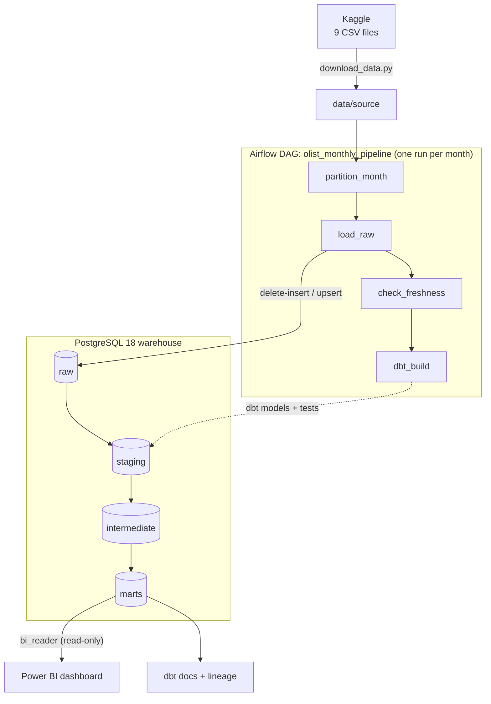
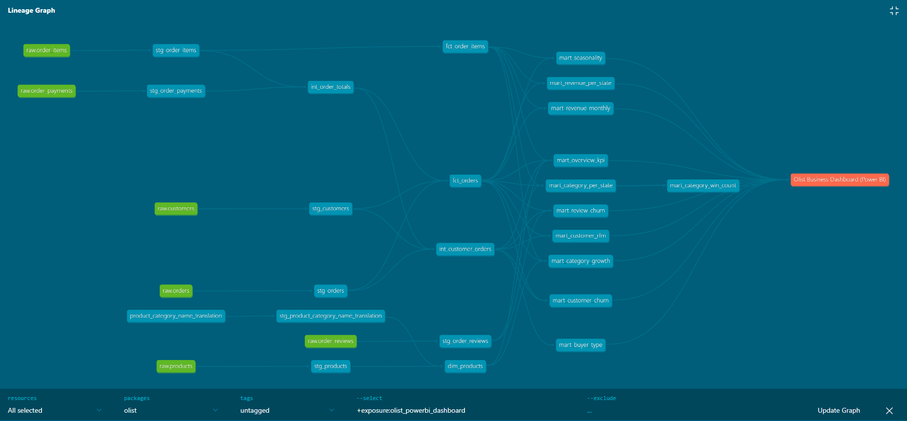
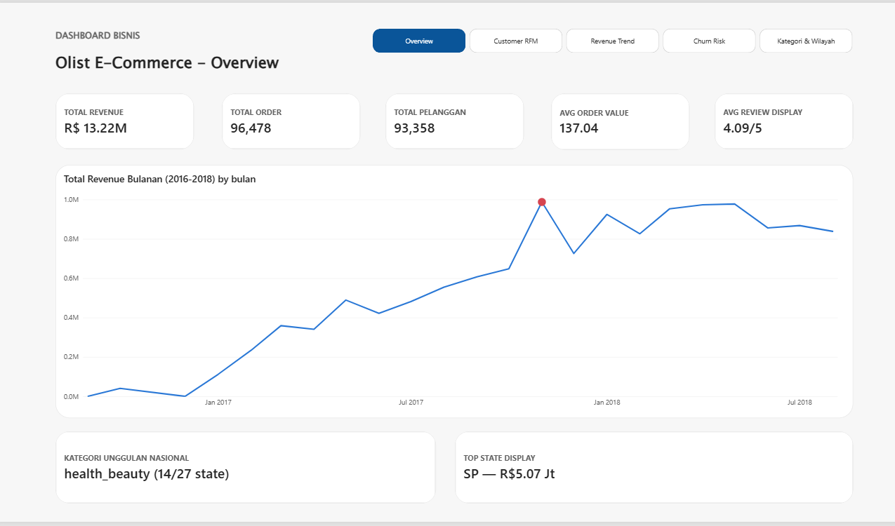
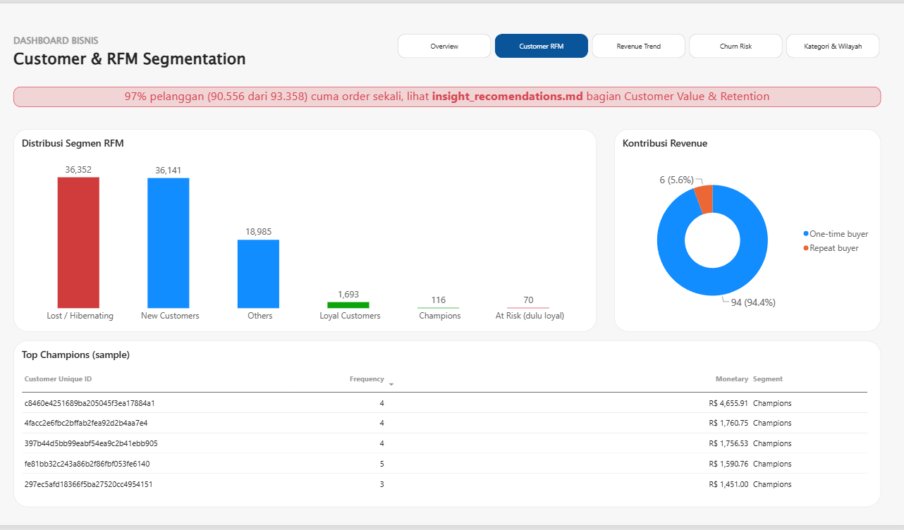
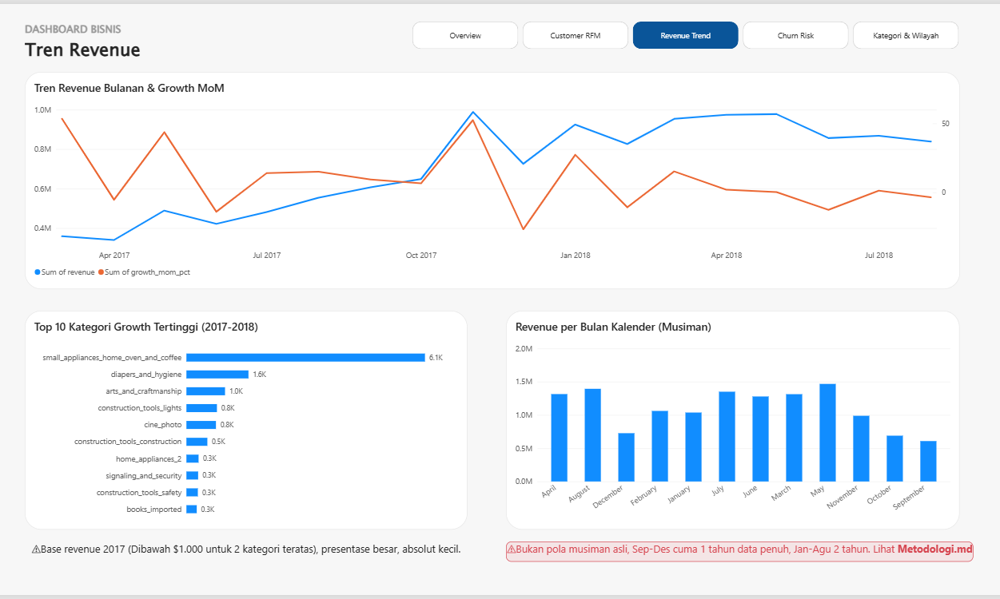
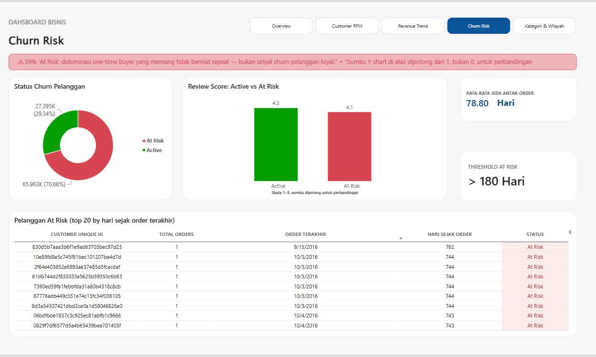
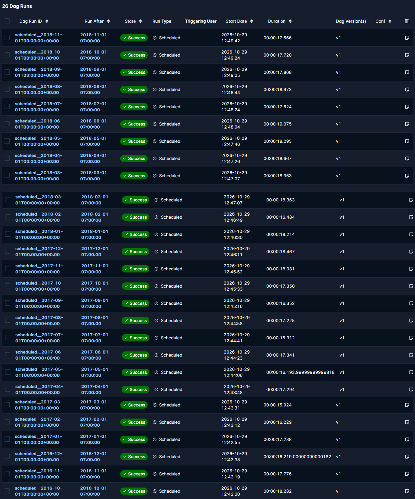

# Olist Data Pipeline

[](https://github.com/rohid001/olist-data-pipeline/actions/workflows/ci.yml)


*Bahasa Indonesia: [README.id.md](README.id.md)*

A monthly batch ELT pipeline for the [Olist Brazilian E-Commerce dataset](https://www.kaggle.com/datasets/olistbr/brazilian-ecommerce)
(99,441 orders, Sep 2016 – Oct 2018). It turns my earlier Data Analyst project,
[olist-sql-dashboard](https://github.com/rohid001/olist-sql-dashboard), from SQL files run by hand into
an automated, tested pipeline: Python ingestion → PostgreSQL → dbt → Airflow → Power BI, all started with
`docker compose up`.

The business logic (RFM segments, revenue trend, churn, category and region analysis) is the same as in
the DA project, and a regression check proves the new marts return the same numbers.

## Results at a glance

| Metric | Before (DA project) | After (this pipeline) |
| --- | --- | --- |
| Steps to rebuild the dashboard data | 15 manual runs (2 notebooks, 2 setup SQL files, 11 queries) + Power BI refresh | `docker compose up -d` and unpause 2 DAGs; then one scheduled run per month |
| SQL stored inside Power BI | 351 lines in 12 native queries | 0 lines: the 12 queries read tables in `marts` |
| Parity with the DA results | checked by eye, query by query | 10 marts compared automatically: 9 identical, 1 explained difference ([report](docs/regression_report.md)) |
| Monthly batches | none (one-off load) | 26 of 26 Airflow runs succeeded, including an empty month (Nov 2016) |
| Full backfill time | not measured | 7 min 59.9 s on a desktop PC (about 18.5 s per month) |
| Idempotency | reloading duplicated rows | re-running a month changes 0 row counts in `raw` and `marts` |
| Automated tests | 0 | 71 dbt data tests + 9 pytest unit tests: 0 errors, 2 intentional warnings; sqlfluff 0 violations |
| CI | none | GitHub Actions on every push, about 1 min 16 s; a pull request that breaks SQL lint is blocked |
| BI access | database owner account | read-only `bi_reader` role that can only read `marts` |

## Architecture



- **Ingestion (Python).** `partition.py` splits each source CSV into monthly partitions
  (`data/landing/<table>/month=YYYY-MM/`) based on the data contract in `ingestion/data_contract.py`.
  `load_raw.py` loads one month into the `raw` schema in a single transaction: fact tables use
  delete-insert by `_batch_id`, dimension tables use upsert, so a month can be reloaded safely.
- **Transformation (dbt).** 27 models in three layers: staging (rename, cast, deduplicate),
  intermediate (reusable joins), and marts (`dim_`/`fct_` plus 11 analytics marts). `fct_orders` is
  incremental (`delete+insert` on `order_id`).
- **Orchestration (Airflow 3).** Each DAG run processes one month: partition, load, source freshness
  check, `dbt build`. `catchup=True` with `max_active_runs=1` replays all 26 months in order.
- **Serving (Power BI).** The original 5-page dashboard now reads `marts` tables through a read-only
  user. The dashboard is registered as a dbt exposure, so it appears at the end of the lineage graph.



**Live dbt docs:** <https://rohid001.github.io/olist-data-pipeline/dbt/>

## Tech stack

| Area | Tools |
| --- | --- |
| Containers | Docker Desktop (WSL2) + Docker Compose |
| Warehouse | PostgreSQL 18 |
| Ingestion | Python 3.12, pandas 3.0, SQLAlchemy 2.1, psycopg2, kagglehub |
| Transformation | dbt-core 1.12 + dbt-postgres 1.11 (pinned: dbt v2 does not support Postgres yet) |
| Orchestration | Apache Airflow 3.3.2, LocalExecutor, dbt in a separate venv inside the image |
| Code quality | dbt data tests, pytest, sqlfluff (dbt templater) |
| CI | GitHub Actions with a PostgreSQL service container |
| Serving | Power BI Desktop (Import mode), dbt docs |

## Data quality

- **71 dbt data tests**: keys (`unique`, `not_null`), `relationships` between layers, `accepted_values`,
  and 4 singular tests from the DA data audit (for example: total revenue must match across three marts).
- **Source freshness** on `raw.orders` before every `dbt build` in Airflow.
- **Two intentional warnings** are real findings in the Olist data, not bugs: 303 orders whose payment
  total differs from item price + freight, and 44 reviews created before their order date.
- **Regression check** (`scripts/regression_check.py`): compares every mart with the CSV exports of the
  DA project. One known difference comes from an arbitrary `DISTINCT ON` tie-break in the DA view.

## CI

On every push to `main` and every pull request, GitHub Actions starts a temporary PostgreSQL 18 service
and runs: pytest → sqlfluff lint → load a 445-order sample (all 26 months, in `tests/fixtures/`) →
`dbt build` → re-run one month to exercise the incremental path of `fct_orders`.

## Dashboard

| Overview | Customer RFM |
| --- | --- |
|  |  |

| Revenue Trend | Churn Risk |
| --- | --- |
|  |  |

Airflow backfill of all 26 months:



## How to run

Requirements: Windows 10/11 with Docker Desktop, Python 3.12, about 8 GB RAM for Docker, and a
[Kaggle API token](https://www.kaggle.com/settings) to download the dataset.

```powershell
git clone https://github.com/rohid001/olist-data-pipeline.git
cd olist-data-pipeline
python -m venv .venv
.venv\Scripts\Activate.ps1
pip install -r requirements.txt

Copy-Item .env.example .env          # then fill in the passwords in .env
python -m ingestion.download_data    # 9 CSV files into data/source

docker compose build
docker compose up -d
docker compose exec airflow-scheduler airflow dags unpause olist_static_reference
docker compose exec airflow-scheduler airflow dags unpause olist_monthly_pipeline
```

Open Airflow at <http://localhost:8080> (user `admin`, password `AIRFLOW_ADMIN_PASSWORD` from `.env`)
and watch the 26 monthly runs. When they are done:

```powershell
python -m scripts.create_bi_reader    # read-only user for Power BI
cd dbt\olist
dbt docs generate
dbt docs serve --port 8081            # lineage graph at http://localhost:8081
```

Without Airflow, the same pipeline runs by hand: `python -m ingestion.partition --all`,
`python -m ingestion.load_raw --all`, then `dbt build` from `dbt\olist`.

## Repository structure

```text
olist-data-pipeline/
├── docker-compose.yml        # warehouse + Airflow
├── Dockerfile                # Airflow image with a separate venv for the pipeline
├── ingestion/                # config, data contract, download, partition, load_raw
├── scripts/                  # regression check, CI sample builder, bi_reader setup
├── dbt/olist/                # dbt project: models, seed, tests, exposure
├── airflow/dags/             # monthly pipeline + static reference DAG
├── tests/                    # pytest unit tests + CI sample data
├── .github/workflows/ci.yml  # GitHub Actions
├── dashboard/                # Power BI file + screenshots
├── warehouse/init/           # schemas created on first start
└── docs/                     # regression report, lineage image, dbt docs site
```

## Limitations

- **Replay, not live data.** The dataset is a static snapshot that keeps only the final status of each
  order. The monthly pipeline replays history; it cannot show status updates or late changes to an order.
- **Local only.** Everything runs on one machine with Docker Compose and the LocalExecutor. There is no
  cloud deployment, to keep the project free.
- **CI uses a sample.** CI checks the code on 445 orders. Full-data checks (regression against the DA
  results, full backfill) run locally, because the DA CSV exports are not in this repository.
- **Power BI.** Import mode with a manual refresh; Power BI Desktop runs on Windows only. Column names in
  the report keep the original Indonesian names through a rename step in Power Query.
- **Data license.** The Olist dataset is CC BY-NC-SA 4.0 (non-commercial). The data is already anonymised.

## Related project

- [olist-sql-dashboard](https://github.com/rohid001/olist-sql-dashboard): the original Data Analyst
  project with the business questions, SQL analysis, and insights.

## License

Code: [MIT](LICENSE). Data: [Olist, CC BY-NC-SA 4.0](https://www.kaggle.com/datasets/olistbr/brazilian-ecommerce).

Built by [Rohid Aji Sunan](https://github.com/rohid001).