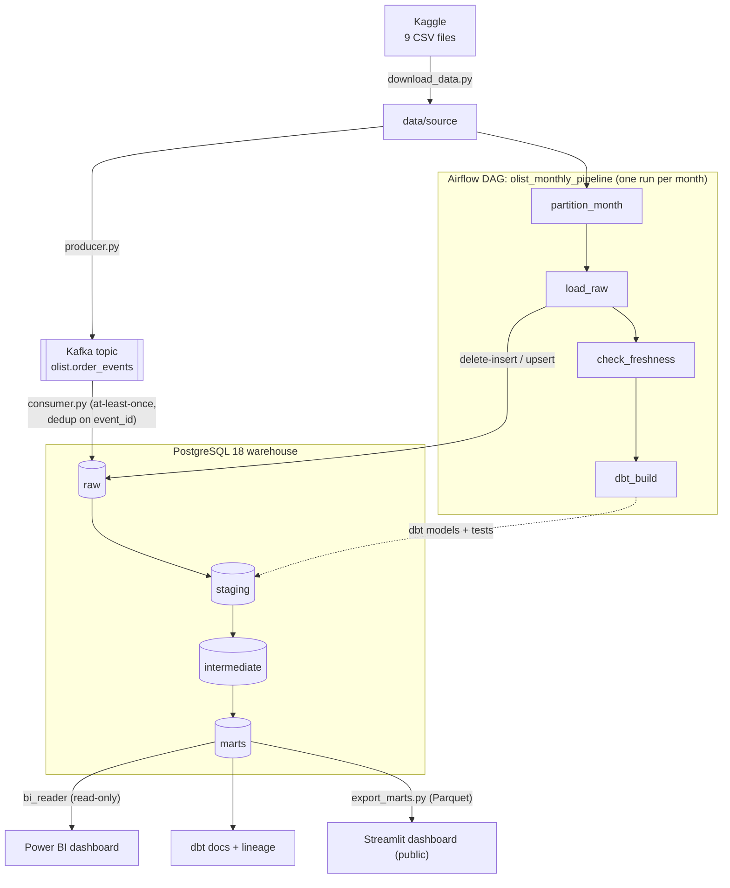
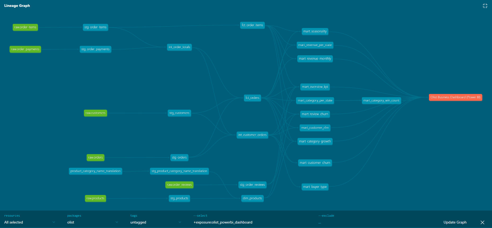
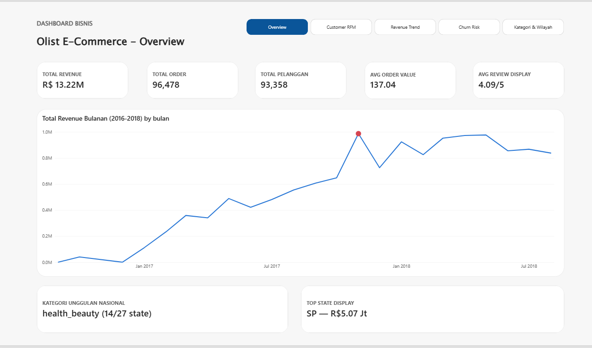
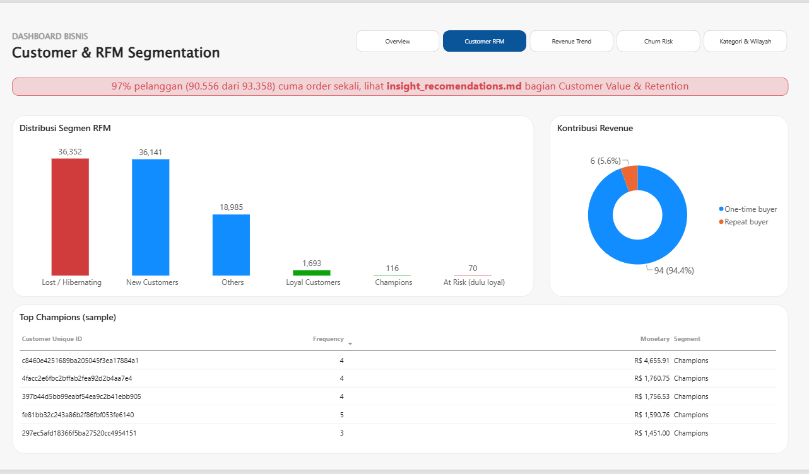
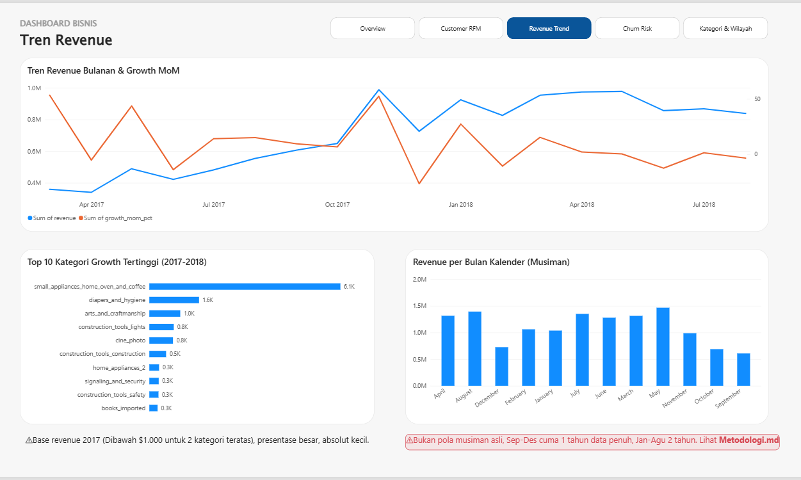
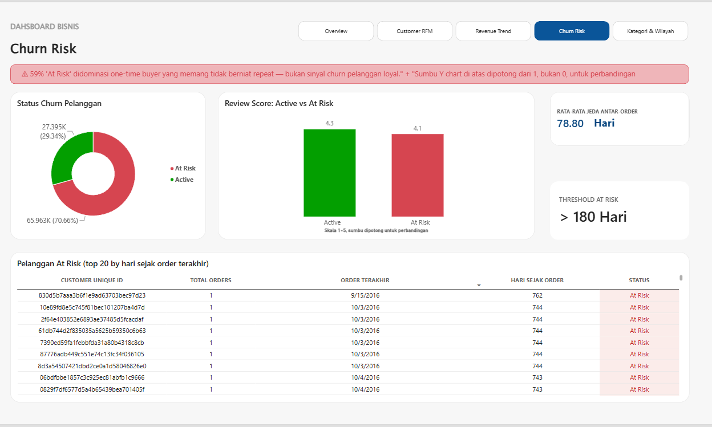
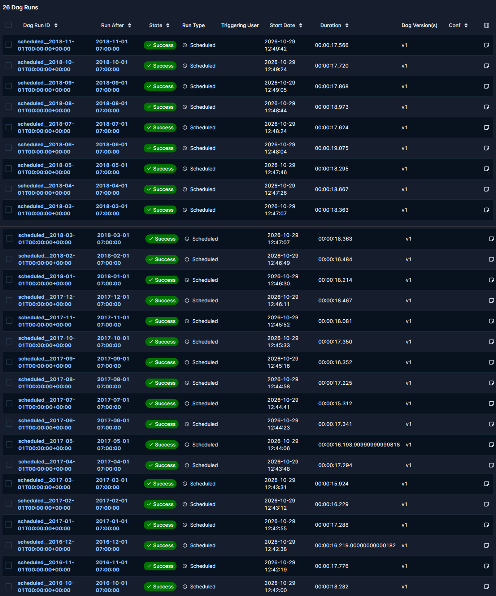

# Olist Data Pipeline

[](https://github.com/rohid001/olist-data-pipeline/actions/workflows/ci.yml)


*Bahasa Indonesia: [README.id.md](README.id.md)*

**Live dashboard:** <https://olist-data-pipeline.streamlit.app> · **Live dbt docs:** <https://rohid001.github.io/olist-data-pipeline/dbt/>

A monthly batch ELT pipeline for the [Olist Brazilian E-Commerce dataset](https://www.kaggle.com/datasets/olistbr/brazilian-ecommerce)
(99,441 orders placed Sep 2016 – Oct 2018; the delivered orders used in the analysis run to Aug 2018). It turns my earlier Data Analyst project,
[olist-sql-dashboard](https://github.com/rohid001/olist-sql-dashboard), from SQL files run by hand into
an automated, tested pipeline: Python ingestion → PostgreSQL → dbt → Airflow → Power BI and Streamlit, all started with
`docker compose up`. A second path replays the order history as events through Apache Kafka, to show
how the same warehouse handles duplicate and late-arriving events.

The business logic (RFM segments, revenue trend, churn, category and region analysis) is the same as in
the DA project, and a regression check proves the new marts return the same numbers.

## Results at a glance

| Metric | Before (DA project) | After (this pipeline) |
| --- | --- | --- |
| Steps to rebuild the dashboard data | 15 manual runs (2 notebooks, 2 setup SQL files, 11 queries) + Power BI refresh | `docker compose up -d` and unpause 2 DAGs; then one scheduled run per month |
| SQL stored inside Power BI | 351 lines in 12 native queries | 0 lines: the 12 queries read tables in `marts` |
| Parity with the DA results | checked by eye, query by query | 10 marts compared automatically: 9 identical, 1 explained difference ([report](docs/regression_report.md)) |
| Monthly batches | none (one-off load) | 26 of 26 Airflow runs succeeded, including an empty month (Nov 2016) |
| Full backfill time | not measured | 7 min 59.9 s on a desktop PC (about 18.5 s per month) |
| Idempotency | reloading duplicated rows | re-running a month changes 0 row counts in `raw` and `marts` |
| Automated tests | 0 | 82 dbt data tests + 20 pytest tests (16 unit, 4 dashboard smoke tests): 0 errors, 2 intentional warnings; sqlfluff 0 violations |
| Event streaming | none | 392,856 order events replayed through Kafka with 7,846 deliberate duplicates and 19,492 late events: the stream table matches the batch data with 0 mismatches, a consumer crash loses or duplicates 0 events, and replaying the full history a second time (853,484 messages in the topic) still leaves exactly 392,856 rows |
| CI/CD | none | GitHub Actions on every push and pull request: pre-commit, tests, lint, `dbt build`, and a golden test of all 11 dashboard marts; dbt docs published automatically to GitHub Pages |
| BI access | database owner account | read-only `bi_reader` role that can only read `marts` |
| Public access to the results | a Power BI file that only opens on Windows | a public Streamlit dashboard and dbt docs site, nothing to install |

## Architecture



- **Ingestion (Python).** `partition.py` splits each source CSV into monthly partitions
  (`data/landing/<table>/month=YYYY-MM/`) based on the data contract in `ingestion/data_contract.py`.
  `load_raw.py` loads one month into the `raw` schema in a single transaction: fact tables use
  delete-insert by `_batch_id`, dimension tables use upsert, so a month can be reloaded safely.
- **Streaming (Kafka).** `streaming/producer.py` replays the four timestamps of every order (created,
  approved, shipped, delivered) as events, sending some late and some twice on purpose.
  `streaming/consumer.py` writes them to `raw.order_events` and commits Kafka offsets only after the
  database commit; duplicates are dropped by the `event_id` primary key. `fct_order_lifecycle` is
  incremental on arrival time, so late events are picked up by the next run. Details in
  [docs/architecture.md](docs/architecture.md#9-event-stream-kafka).
- **Transformation (dbt).** 30 models in three layers: staging (rename, cast, deduplicate),
  intermediate (reusable joins), and marts (`dim_`/`fct_` plus 11 analytics marts). `fct_orders` is
  incremental (`delete+insert` on `order_id`).
- **Orchestration (Airflow 3).** Each DAG run processes one month: partition, load, source freshness
  check, `dbt build`. `catchup=True` with `max_active_runs=1` replays all 26 months in order.
- **Serving (Power BI).** The original 5-page dashboard now reads `marts` tables through a read-only
  user. The dashboard is registered as a dbt exposure, so it appears at the end of the lineage graph.
- **Serving (public web).** `scripts/export_marts.py` exports the 11 marts used by the dashboard to
  Parquet files in `app/data/`; a Streamlit app with the same 5 pages reads them and is hosted for free
  on Streamlit Community Cloud. It is registered as a second dbt exposure.



## Tech stack

| Area | Tools |
| --- | --- |
| Containers | Docker Desktop (WSL2) + Docker Compose |
| Warehouse | PostgreSQL 18 |
| Ingestion | Python 3.12, pandas 3.0, SQLAlchemy 2.1, psycopg2, kagglehub |
| Transformation | dbt-core 1.12 + dbt-postgres 1.11 (pinned: dbt v2 does not support Postgres yet) |
| Orchestration | Apache Airflow 3.3.2, LocalExecutor, dbt in a separate venv inside the image |
| Streaming | Apache Kafka 4.4 (single node, KRaft), confluent-kafka 2.16 |
| Code quality | dbt data tests, pytest, sqlfluff (dbt templater), ruff, pre-commit |
| CI/CD | GitHub Actions with PostgreSQL and Kafka service containers, GitHub Pages |
| Serving | Power BI Desktop (Import mode), Streamlit 1.66 on Streamlit Community Cloud, dbt docs |

## Data quality

- **82 dbt data tests**: keys (`unique`, `not_null`), `relationships` between layers, `accepted_values`,
  4 singular tests from the DA data audit (for example: total revenue must match across three marts),
  and 1 that checks the Kafka events against the batch data.
- **Source freshness** on `raw.orders` before every `dbt build` in Airflow.
- **Two intentional warnings** are real findings in the Olist data, not bugs: 303 orders whose payment
  total differs from item price + freight, and 44 reviews created before their order date.
- **Regression check** (`scripts/regression_check.py`): compares every mart with the CSV exports of the
  DA project. One known difference comes from an arbitrary `DISTINCT ON` tie-break in the DA view.

## CI/CD

On every push to `main` and every pull request, GitHub Actions starts temporary PostgreSQL 18 and
Kafka 4.4 services and runs:

1. **pre-commit**: trailing whitespace, final newlines, YAML syntax, large files, private keys, ruff.
2. **pytest**: unit tests plus a headless smoke test of the Streamlit app.
3. **sqlfluff** lint of all dbt SQL.
4. **Pipeline on a 445-order sample** (all 26 months, in `tests/fixtures/`): partition, load, replay the
   sample's order events through Kafka, `dbt build`, then a re-run of one month to exercise the
   incremental path of `fct_orders`.
5. **Golden test**: the 11 dashboard marts must match the snapshot in `tests/fixtures/expected_marts/`, so
   an unintended change in business logic fails the build.
6. **Pull requests** get an impact summary: the models and dashboards affected by the change, found with
   `dbt ls --select state:modified+` against the manifest of `main`.
7. **Pushes to `main`** publish the dbt docs site and manifest to GitHub Pages.

## Dashboard

The same 5 pages are available as a public web app: <https://olist-data-pipeline.streamlit.app>.
Power BI screenshots:

| Overview | Customer RFM |
| --- | --- |
|  |  |

| Revenue Trend | Churn Risk |
| --- | --- |
|  |  |

Airflow backfill of all 26 months:



## How to run

Requirements: Windows 10/11 with Docker Desktop, Python 3.12, about 8 GB RAM for Docker, and a
[Kaggle API token](https://www.kaggle.com/settings) to download the dataset.

```powershell
git clone https://github.com/rohid001/olist-data-pipeline.git
cd olist-data-pipeline
python -m venv .venv
.venv\Scripts\Activate.ps1
pip install -r requirements.txt
pre-commit install                   # run the checks before every commit

Copy-Item .env.example .env          # then fill in the passwords in .env
python -m ingestion.download_data    # 9 CSV files into data/source

docker compose build
docker compose up -d
docker compose exec airflow-scheduler airflow dags unpause olist_static_reference
docker compose exec airflow-scheduler airflow dags unpause olist_monthly_pipeline
```

Open Airflow at <http://localhost:8080> (user `admin`, password `AIRFLOW_ADMIN_PASSWORD` from `.env`)
and watch the 26 monthly runs. When they are done:

```powershell
python -m scripts.create_bi_reader    # read-only user for Power BI
cd dbt\olist
dbt docs generate
dbt docs serve --port 8081            # lineage graph at http://localhost:8081
```

To refresh and run the public dashboard locally:

```powershell
python -m scripts.export_marts           # marts -> app/data/*.parquet
pip install -r app/requirements.txt
streamlit run app/streamlit_app.py      # http://localhost:8501
```

To replay the order history through Kafka (two terminals, venv active in both):

```powershell
docker compose --profile streaming up -d kafka
python -m streaming.consumer                               # terminal 1, stop with Ctrl+C
python -m streaming.producer --month 2017-11 --speed 86400 # terminal 2: one day of data per second
python -m streaming.stream_report                          # duplicates, late events, latency, lag
```

Without Airflow, the same pipeline runs by hand: `python -m ingestion.partition --all`,
`python -m ingestion.load_raw --all`, then `dbt build` from `dbt\olist`.

## Repository structure

```text
olist-data-pipeline/
├── docker-compose.yml        # warehouse + Airflow, Kafka in the "streaming" profile
├── Dockerfile                # Airflow image with a separate venv for the pipeline
├── ingestion/                # config, data contract, download, partition, load_raw
├── streaming/                # Kafka producer, consumer, stream report
├── scripts/                  # regression check, CI sample builder, bi_reader setup, mart export
├── app/                      # public Streamlit dashboard + Parquet snapshot of the marts
├── dbt/olist/                # dbt project: models, seed, tests, 2 exposures
├── airflow/dags/             # monthly pipeline + static reference DAG
├── tests/                    # pytest tests, CI sample data, mart snapshot for the golden test
├── .github/workflows/ci.yml  # GitHub Actions
├── dashboard/                # Power BI file + screenshots
├── warehouse/init/           # schemas and the order events table, created on first start
└── docs/                     # architecture, regression report, images
```

## Limitations

- **Replay, not live data.** The dataset is a static snapshot that keeps only the final status of each
  order. The monthly pipeline replays history; it cannot show status updates or late changes to an order.
- **Stream from a snapshot.** The events are rebuilt from the four timestamps in the orders table, so
  there is no event for a cancellation (the dataset has no cancellation time). The stream uses one
  broker, JSON messages without a schema registry, and no dead-letter topic.
- **Local only.** Everything runs on one machine with Docker Compose and the LocalExecutor. There is no
  cloud deployment, to keep the project free.
- **CI uses a sample.** CI checks the code on 445 orders, and the dbt docs site is built from that sample.
  Full-data checks (regression against the DA results, full backfill) run locally, because the DA CSV
  exports are not in this repository.
- **Dashboard snapshot.** The public dashboard reads a Parquet snapshot committed to the repo, so it
  shows new data only after `export_marts.py` is re-run and the files are pushed.
- **Power BI.** Import mode with a manual refresh; Power BI Desktop runs on Windows only. Column names in
  the report keep the original Indonesian names through a rename step in Power Query.
- **Data license.** The Olist dataset is CC BY-NC-SA 4.0 (non-commercial). The data is already anonymised.

## Related project

- [olist-sql-dashboard](https://github.com/rohid001/olist-sql-dashboard): the original Data Analyst
  project with the business questions, SQL analysis, and insights.

## License

Code: [MIT](LICENSE). Data: [Olist, CC BY-NC-SA 4.0](https://www.kaggle.com/datasets/olistbr/brazilian-ecommerce).

Built by [Rohid Aji Sunan](https://github.com/rohid001).
